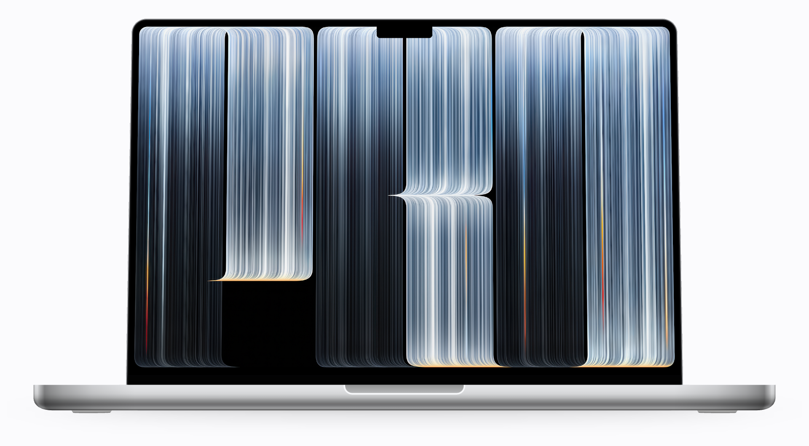
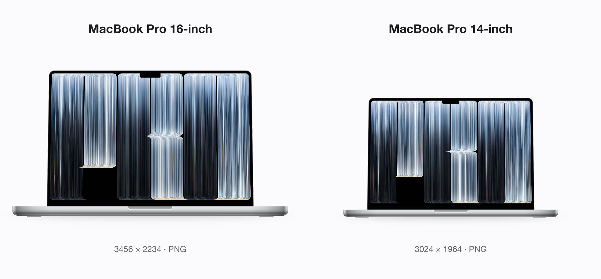
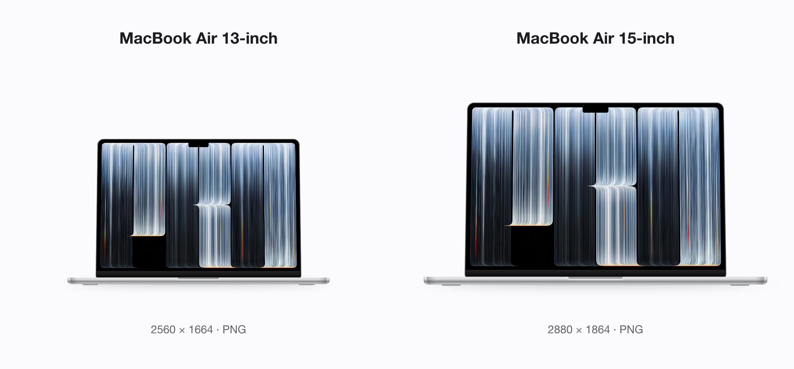
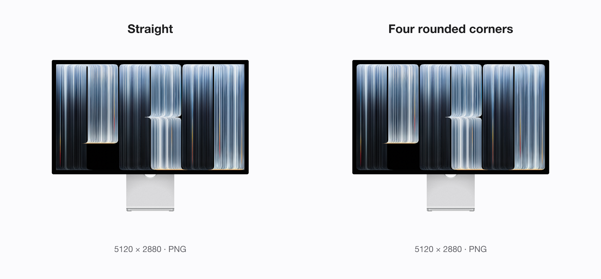
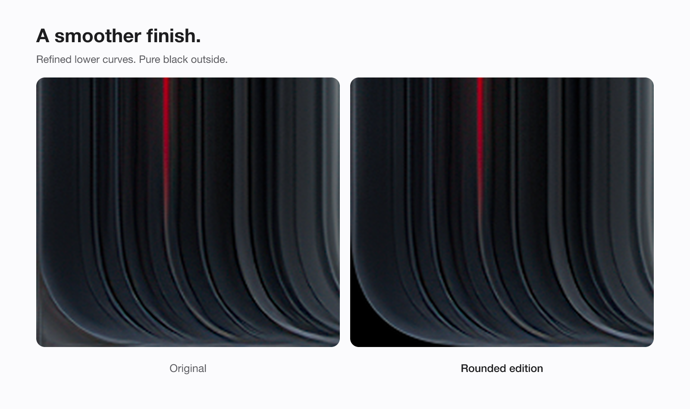
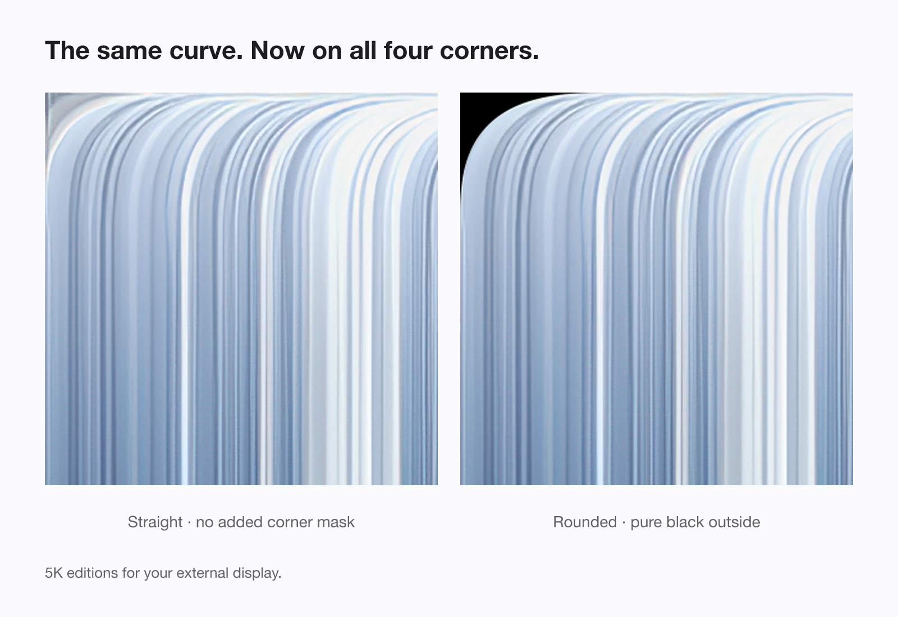

# PROLED Wallpaper

**The new MacBook Pro look. On your Mac.**

<a href="https://github.com/ReffWu/proled-wallpaper/releases/latest/download/proled-wallpapers-all-sizes.zip">
  <picture>
    <source media="(prefers-color-scheme: dark)" srcset="assets/readme/download-en-dark.png">
    
  </picture>
</a>

Free downloads · Five Mac sizes · Lossless PNG · No app needed

English · [简体中文](README.zh-CN.md)

[Explore the wallpaper](https://reffwu.github.io/proled-wallpaper/) · [Download all five sizes](https://github.com/ReffWu/proled-wallpaper/releases/latest/download/proled-wallpapers-all-sizes.zip)

  <picture>
    <source media="(prefers-color-scheme: dark)" srcset="assets/readme/hero-dark.png">
    
  </picture>

The new MacBook Pro wallpaper, prepared for the Mac you already love. Refined black corners for a softer finish. An unmasked 5K edition for a full rectangular image.

- **One continuous curve.** Matching lower corners on MacBook editions; all four corners on the rounded 5K edition.
- **Pure black outside.** The rounded editions fade smoothly into black along the curve, with no extra gray outside.
- **Your display, your finish.** Five display sizes, with both straight and four-corner 5K choices.
- **Lossless PNG.** Available source detail preserved. Free downloads, no app needed.

## Made to fit your Mac.

### MacBook Pro

  <picture>
    <source media="(prefers-color-scheme: dark)" srcset="assets/readme/family-pro-dark.png">
    
  </picture>

[16-inch · 3456 × 2234](https://github.com/ReffWu/proled-wallpaper/releases/latest/download/proled-macbook-pro-16-3456x2234.png) · [14-inch · 3024 × 1964](https://github.com/ReffWu/proled-wallpaper/releases/latest/download/proled-macbook-pro-14-3024x1964.png)

### MacBook Air

  <picture>
    <source media="(prefers-color-scheme: dark)" srcset="assets/readme/family-air-dark.png">
    
  </picture>

[13-inch · 2560 × 1664](https://github.com/ReffWu/proled-wallpaper/releases/latest/download/proled-macbook-air-13-2560x1664.png) · [15-inch · 2880 × 1864](https://github.com/ReffWu/proled-wallpaper/releases/latest/download/proled-macbook-air-15-2880x1864.png)

The 13-inch edition fits M2-and-later 13.6-inch displays.

### Mac Studio · 5K display

  <picture>
    <source media="(prefers-color-scheme: dark)" srcset="assets/readme/family-studio-dark.png">
    
  </picture>

Your external display, with a choice of finish. Both are **5120 × 2880**.

[Straight · no added corner mask](https://github.com/ReffWu/proled-wallpaper/releases/latest/download/proled-mac-studio-5k-straight-5120x2880.png) · [Rounded · all four corners](https://github.com/ReffWu/proled-wallpaper/releases/latest/download/proled-mac-studio-5k-rounded-5120x2880.png)

## A smoother finish.

The lower curves follow one continuous, mirrored contour. Pixels outside the curve are pure black; the edge has a fine antialiased transition. The rest of the artwork keeps its light and texture.

  <picture>
    <source media="(prefers-color-scheme: dark)" srcset="assets/readme/edge-dark.png">
    
  </picture>

See the upper corners on the rounded 5K edition

  <picture>
    <source media="(prefers-color-scheme: dark)" srcset="assets/readme/studio-corners-dark.png">
    
  </picture>

The **straight 5K edition** uses the original rectangular source without adding a corner mask. The **rounded 5K edition** applies the same curve to all four corners. These are wallpaper treatments; the physical display shape stays the same.

## Download your wallpaper.

| Your Mac | Finish | Resolution | Download |
|---|---|---:|---|
| MacBook Pro 16-inch | Lower corners | 3456 × 2234 | [PNG](https://github.com/ReffWu/proled-wallpaper/releases/latest/download/proled-macbook-pro-16-3456x2234.png) |
| MacBook Pro 14-inch | Lower corners | 3024 × 1964 | [PNG](https://github.com/ReffWu/proled-wallpaper/releases/latest/download/proled-macbook-pro-14-3024x1964.png) |
| MacBook Air 13-inch | Lower corners | 2560 × 1664 | [PNG](https://github.com/ReffWu/proled-wallpaper/releases/latest/download/proled-macbook-air-13-2560x1664.png) |
| MacBook Air 15-inch | Lower corners | 2880 × 1864 | [PNG](https://github.com/ReffWu/proled-wallpaper/releases/latest/download/proled-macbook-air-15-2880x1864.png) |
| Mac Studio / 5K display | Straight | 5120 × 2880 | [PNG](https://github.com/ReffWu/proled-wallpaper/releases/latest/download/proled-mac-studio-5k-straight-5120x2880.png) |
| Mac Studio / 5K display | Four corners | 5120 × 2880 | [PNG](https://github.com/ReffWu/proled-wallpaper/releases/latest/download/proled-mac-studio-5k-rounded-5120x2880.png) |

[Download the complete set · six PNGs](https://github.com/ReffWu/proled-wallpaper/releases/latest/download/proled-wallpapers-all-sizes.zip)

The original lower-corner-only 5K edition remains available [here](https://github.com/ReffWu/proled-wallpaper/releases/latest/download/proled-mac-studio-5k-5120x2880.png).

## Ready to share.

[Download the media kit](https://github.com/ReffWu/proled-wallpaper/releases/latest/download/proled-wallpaper-media-kit.zip): bilingual covers, device lineups, corner details, 5K finishes and short videos, with ready-to-edit captions. [Preview the kit](marketing/README.md).

## A new desktop. In a moment.

1. Download the PNG for your Mac.
2. Open **System Settings → Wallpaper** and add the image.
3. Enjoy the new view.

## Made with care. Shared with credit.

Original artwork from Apple. The source wallpaper was extracted and adapted by [Basic Apple Guy](https://basicappleguy.com/haberdashery/macbook-pro-proled-xdr). The rounded edition and Mac sizes are by [ReffWu](https://github.com/ReffWu).

This is an independent wallpaper adaptation. Image rights remain with their original owners; our processing code is [MIT licensed](LICENSE).

[Behind the details](docs/method.md) · [Processing tools](docs/development.md) · [Credits](ATTRIBUTION.md)
