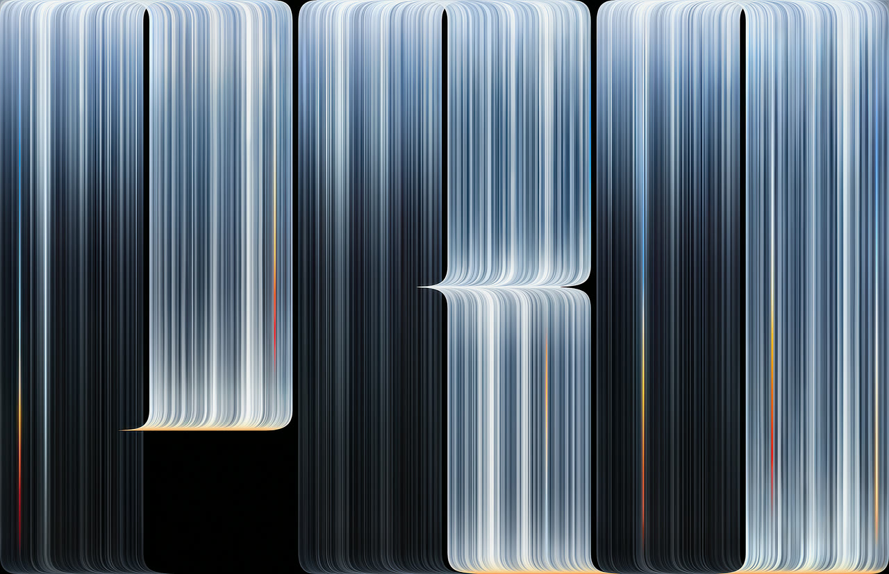
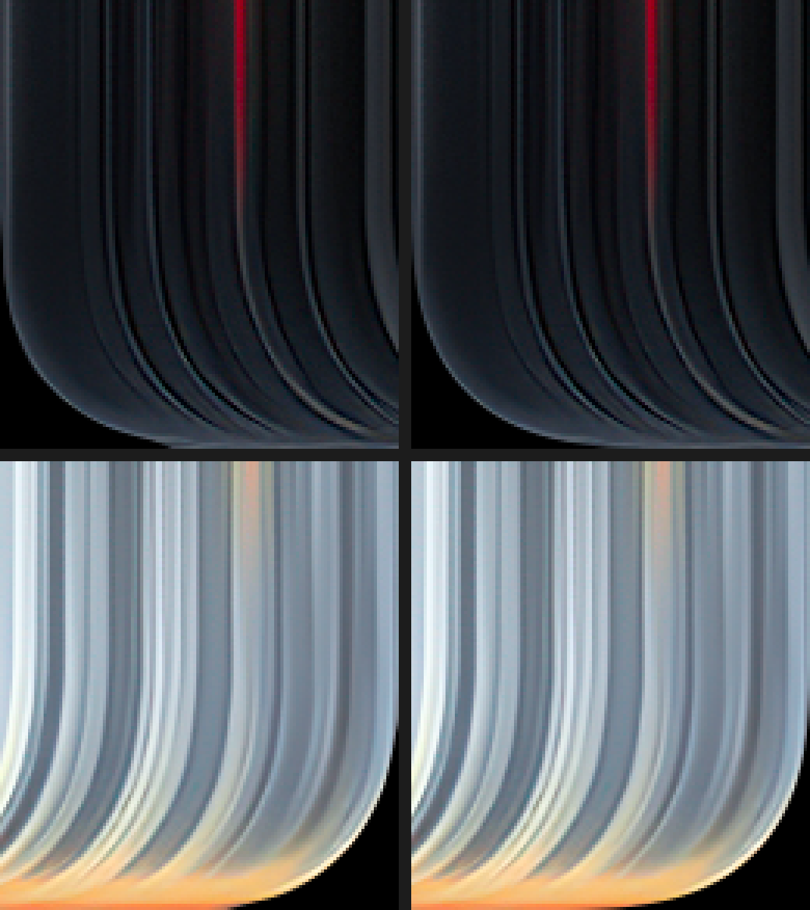

# PROLED Rounded Wallpapers · 纯黑底部圆角壁纸

把 PROLED 壁纸最底下左右两侧的曲线重新拟合为平滑圆角，并将曲线外侧填充为**纯黑 `#000000`**，让壁纸图案呈现自然的底部圆角效果。提供五种机型尺寸的无损 PNG，可直接下载。

Rounded bottom corners, pure-black corner exteriors, and five lossless PNG sizes for Mac. Processing tools are open source.



> 上图为网页预览；下方下载链接均为完整分辨率 PNG。

## 直接下载

**[一键下载全部五种尺寸 ZIP](https://github.com/ReffWu/proled-rounded-wallpapers/releases/latest/download/proled-wallpapers-all-sizes.zip)** · [查看发行页面](https://github.com/ReffWu/proled-rounded-wallpapers/releases/latest) · [SHA-256 校验文件](https://github.com/ReffWu/proled-rounded-wallpapers/releases/latest/download/SHA256SUMS.txt)

公开链接，无需登录 GitHub，也无需安装软件。

| 适配机型 | 分辨率 | 下载 PNG |
|---|---:|---|
| MacBook Pro 16 英寸 | 3456 × 2234 | [下载 · 19.3 MB](https://github.com/ReffWu/proled-rounded-wallpapers/releases/latest/download/proled-macbook-pro-16-3456x2234.png) |
| MacBook Pro 14 英寸 | 3024 × 1964 | [下载 · 14.9 MB](https://github.com/ReffWu/proled-rounded-wallpapers/releases/latest/download/proled-macbook-pro-14-3024x1964.png) |
| MacBook Air 13 英寸（M2 及以后） | 2560 × 1664 | [下载 · 10.6 MB](https://github.com/ReffWu/proled-rounded-wallpapers/releases/latest/download/proled-macbook-air-13-2560x1664.png) |
| MacBook Air 15 英寸 | 2880 × 1864 | [下载 · 13.4 MB](https://github.com/ReffWu/proled-rounded-wallpapers/releases/latest/download/proled-macbook-air-15-2880x1864.png) |
| Mac Studio 搭配 5K / 16:9 显示器 | 5120 × 2880 | [下载 · 37.1 MB](https://github.com/ReffWu/proled-rounded-wallpapers/releases/latest/download/proled-mac-studio-5k-5120x2880.png) |

13 英寸 Air 版对应 13.6 英寸屏幕的 2560×1664，较早 M1 Air 的 2560×1600 不在这次原生尺寸列表中。Mac Studio 版按 5K、16:9 外接显示器制作；实际适配取决于显示器。

## 我们处理了什么

- **平滑底部曲线**：将左右有效轮廓共同拟合为连续超椭圆，左右严格镜像，消除逐行取点造成的局部凸起。
- **圆角外侧纯黑**：圆弧外侧设为 `RGB(0,0,0)`，边界保留窄幅抗锯齿过渡，模拟壁纸图案底部的圆角外观。
- **完整画布**：保留目标画布尺寸与构图，调整只发生在两个底角区域。
- **保留主体细节**：16 英寸和 5K 版本沿用母图尺寸；其他笔记本尺寸各自从 16 英寸 PNG 母图单次 Lanczos 缩小。最后统一保存为无损 PNG。

### 圆角细节对比

**左列：上一版逐行取点；右列：本次标准化曲线。** 上排为左下角，下排为右下角，同位置、同倍率。



## 设置为壁纸

1. 按机型下载对应 PNG，或者下载 ZIP 后解压。
2. 打开 macOS「系统设置 → 墙纸」，添加下载的图片。
3. 使用匹配屏幕原生尺寸的文件，关闭额外缩放或重新裁切，以便完整保留两角效果。

## 开源处理工具

下载已经做好的壁纸不需要运行代码。若要复现处理，需要 **Node.js 20+** 与 **FFmpeg / ffprobe**；没有 npm 依赖。

```bash
git clone https://github.com/ReffWu/proled-rounded-wallpapers.git
cd proled-rounded-wallpapers
npm test
node scripts/apply-corners.mjs input.png output-rounded.png
```

命令保持输入尺寸，输出无损 RGB PNG；已有输出文件不会被覆盖。该工具只处理圆角，其他目标尺寸需先单次缩小到对应分辨率。

参数在 [`config/corner-model.json`](config/corner-model.json)。[处理方法与验证](docs/method.md)包含公式、拟合误差和验证范围；[`downloads.json`](downloads.json)提供下载地址、尺寸和 SHA-256。

下载五张图片到同一个目录后，可验证完整性：

```bash
node scripts/verify-assets.mjs /path/to/downloaded-wallpapers
```

## 原作署名与许可

原始视觉素材来自 Apple；本项目使用的 PNG 母图由 **[Basic Apple Guy](https://basicappleguy.com/haberdashery/macbook-pro-proled-xdr)** 从 Apple 3D 模型素材提取、放大和适配。我们增加了底部曲线标准化、纯黑外侧及五种尺寸的整理。

处理代码、测试和参数使用 [MIT License](LICENSE)。壁纸素材及其衍生预览的权利仍归原权利人，MIT 许可不涵盖壁纸图像。详见 [来源与署名](ATTRIBUTION.md)。本项目为独立社区修改版。
