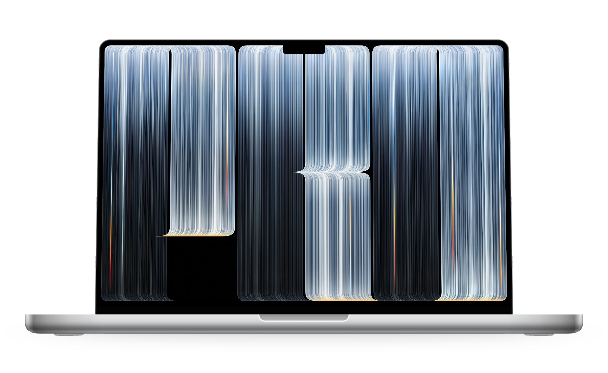
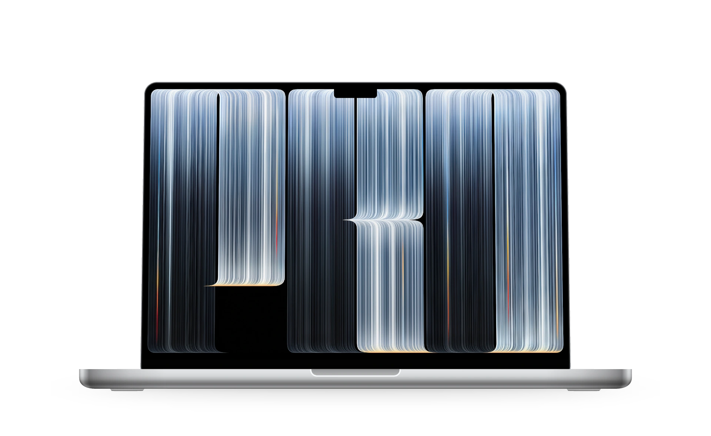
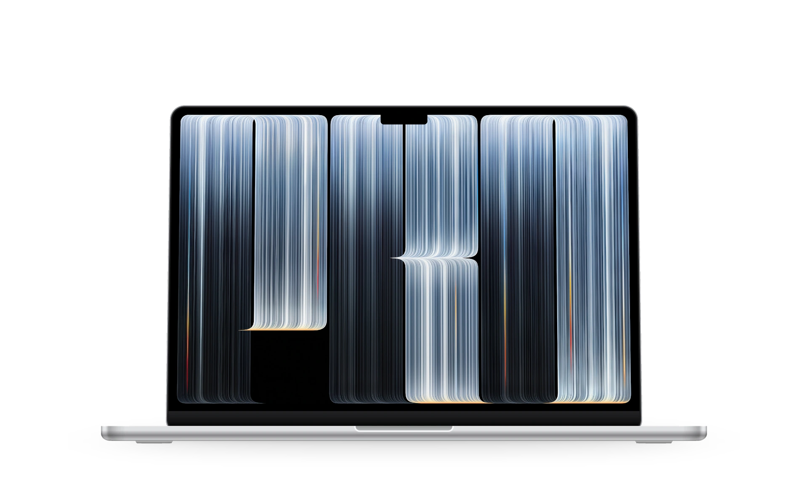
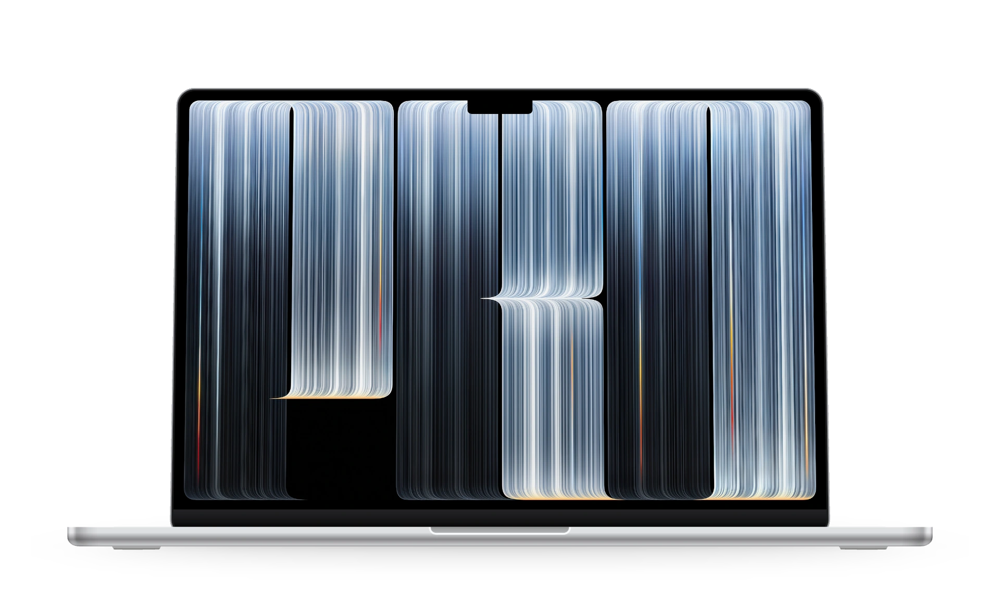
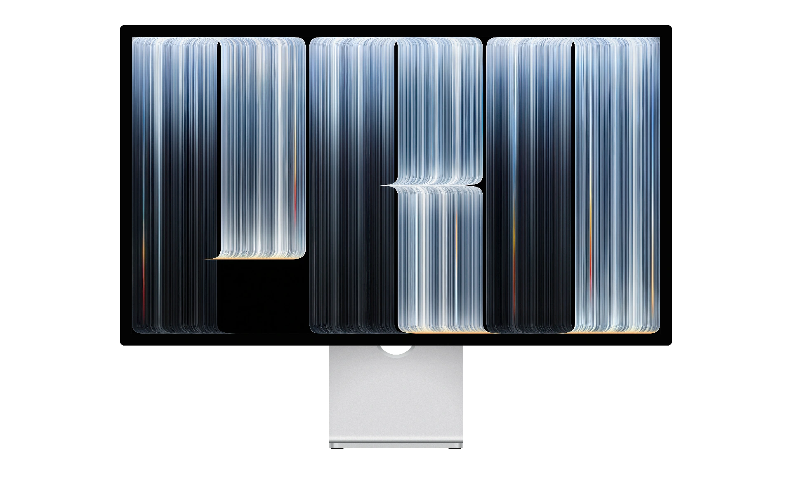

# PROLED Wallpaper

**新款 MacBook Pro 的光影，来到你的桌面。**

<a href="https://github.com/ReffWu/proled-wallpaper/releases/latest/download/proled-wallpapers-all-sizes.zip">
  <picture>
    <source media="(prefers-color-scheme: dark)" srcset="assets/readme/download-zh-dark.png">
    
  </picture>
</a>

免费下载 · 五种 Mac 尺寸 · 无损 PNG · 无需安装 App

[English](README.md) · 简体中文

[看看壁纸效果](https://reffwu.github.io/proled-wallpaper/?lang=zh) · [下载全部五种尺寸](https://github.com/ReffWu/proled-wallpaper/releases/latest/download/proled-wallpapers-all-sizes.zip)

  <picture>
    <source media="(prefers-color-scheme: dark)" srcset="assets/readme/hero-dark.png">
    
  </picture>

把新款 MacBook Pro 的银蓝光影，带到你每天使用的 Mac。我们细致整理了最底下两侧的弧线，让线条沿着圆角，平滑收进纯黑。

- **左右一致的顺滑圆角。** 两侧采用同一条连续弧线，镜像对称，边缘以细腻的像素过渡收尾。
- **弧线之外，都是纯黑。** 去掉圆角外侧多余的灰色区域，让壁纸呈现底部圆角的视觉效果。
- **保留细节，无损导出。** 提供完整分辨率 PNG，保留现有母图细节，避免额外的 JPEG 压缩损失。
- **五款尺寸，下载即用。** 覆盖 MacBook Pro、MacBook Air 与 5K 显示器，直接设置为壁纸，无需安装 App。

## 更顺滑的底部圆角。

熟悉的光影纹理，更细致的收尾。左右圆角保持一致，弧线之外填充纯黑，桌面看起来更干净、完整。

  <picture>
    <source media="(prefers-color-scheme: dark)" srcset="assets/readme/edge-dark.png">
    
  </picture>

## 为你的 Mac，选好尺寸。

五款机型的效果直接看。每张展示图使用对应尺寸的壁纸，下方可直接下载完整分辨率 PNG。

[16 英寸 Pro](#macbook-pro-16-英寸) · [14 英寸 Pro](#macbook-pro-14-英寸) · [13 英寸 Air](#macbook-air-13-英寸) · [15 英寸 Air](#macbook-air-15-英寸) · [Mac Studio / 5K](#mac-studio--5k-显示器)

### MacBook Pro 16 英寸

  

**3456 × 2234 · PNG** — [下载 PNG 壁纸](https://github.com/ReffWu/proled-wallpaper/releases/latest/download/proled-macbook-pro-16-3456x2234.png)

### MacBook Pro 14 英寸

  

**3024 × 1964 · PNG** — [下载 PNG 壁纸](https://github.com/ReffWu/proled-wallpaper/releases/latest/download/proled-macbook-pro-14-3024x1964.png)

### MacBook Air 13 英寸

  

**2560 × 1664 · PNG** — [下载 PNG 壁纸](https://github.com/ReffWu/proled-wallpaper/releases/latest/download/proled-macbook-air-13-2560x1664.png)

适用于 M2 及以后机型的 13.6 英寸屏幕。

### MacBook Air 15 英寸

  

**2880 × 1864 · PNG** — [下载 PNG 壁纸](https://github.com/ReffWu/proled-wallpaper/releases/latest/download/proled-macbook-air-15-2880x1864.png)

### Mac Studio · 5K 显示器

  

**5120 × 2880 · PNG** — [下载 PNG 壁纸](https://github.com/ReffWu/proled-wallpaper/releases/latest/download/proled-mac-studio-5k-5120x2880.png)

以 Studio Display 展示，适用于搭配 Mac Studio 等电脑的 5120 × 2880、16:9 显示器。

[一次下载全部五种尺寸 ZIP](https://github.com/ReffWu/proled-wallpaper/releases/latest/download/proled-wallpapers-all-sizes.zip)

## 换个桌面，只需片刻。

1. 下载适合你 Mac 的 PNG 壁纸。
2. 在「**系统设置 → 墙纸**」中添加图片。
3. 换上新的桌面。

## 细致打磨，也认真署名。

原始视觉素材来自 Apple，母图由 [Basic Apple Guy](https://basicappleguy.com/haberdashery/macbook-pro-proled-xdr) 提取适配。圆角版本与五种尺寸由 [ReffWu](https://github.com/ReffWu) 制作。

本项目是独立社区适配版本。图像权利归原权利人；本项目的处理代码采用 [MIT 许可](LICENSE)。

[细节背后的制作](docs/method.md) · [处理工具](docs/development.md) · [来源与署名](ATTRIBUTION.md)
