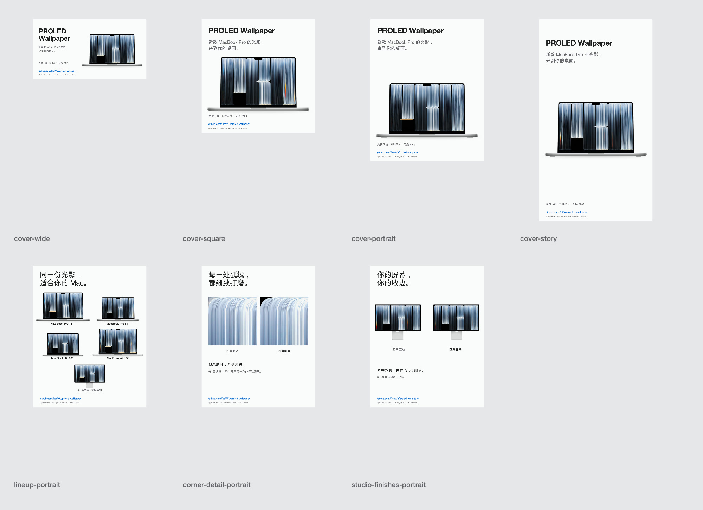

# PROLED Wallpaper · Media Kit

[Download the complete media kit](https://github.com/ReffWu/proled-wallpaper/releases/latest/download/proled-wallpaper-media-kit.zip)

A matched set of English and Chinese images, silent short videos, and editable launch copy. The files show the actual wallpapers on finished device renders.

| Asset | Size | Use |
|---|---:|---|
| `cover-wide-{en,zh}.png` | 1200 × 630 | Landscape share / link cover |
| `cover-square-{en,zh}.png` | 1080 × 1080 | Square post |
| `cover-portrait-{en,zh}.png` | 1080 × 1350 | Portrait cover / carousel opening |
| `cover-story-{en,zh}.png` | 1080 × 1920 | Full-height vertical image |
| `lineup-portrait-{en,zh}.png` | 1080 × 1350 | All five device sizes |
| `corner-detail-portrait-{en,zh}.png` | 1080 × 1350 | Straight versus rounded corner close-up |
| `studio-finishes-portrait-{en,zh}.png` | 1080 × 1350 | Two 5K finishes |
| `launch-{en,zh}.mp4` | 1080 × 1350 | Silent three-scene short video |

14 PNG images and two MP4 videos, plus a contact sheet and captions. The video presents the wallpaper, device sizes, and corner detail in sequence.

Suggested carousel: **cover → device lineup → corner detail → Studio finishes**.

- [中文发布文案](captions.zh-CN.md)
- [English captions](captions.en.md)
- Main destination: [GitHub project](https://github.com/ReffWu/proled-wallpaper)
- Interactive preview: [Wallpaper page](https://reffwu.github.io/proled-wallpaper/)

Original artwork: Apple. Source wallpaper: [Basic Apple Guy](https://basicappleguy.com/haberdashery/macbook-pro-proled-xdr). Adaptation and finished MacBook renders: ReffWu. Studio Display frame: [James Jingyi](https://github.com/jamesjingyi/mockup-device-frames). Image rights remain with their original owners; see [credits](../ATTRIBUTION.md).
